# 沉浸式翻譯 ✕ 本地 LLM：打造完全免費的網頁與 YouTube 字幕翻譯環境 

在日常瀏覽外語網頁或觀看 YouTube 影片時，「沉浸式翻譯（Immersive Translate）」擴充功能一直是許多人的必備利器。

> 什麼？你還沒用過！先看[快速介紹影片](https://youtu.be/YlTfeGpBDAU?t=60)。

沉浸式翻譯免費版預設使用的是 Bing 翻譯，用戶也能手動切換為 Google 翻譯。然而，在閱讀長篇文章或高頻率切換頁面時，這兩項免費服務極容易因請求頻率超限而頻繁報錯中斷；若想改用高品質的雲端 AI 模型，得支付訂閱費或 API 調用費。

 

如果不想被流量限制打斷閱讀節奏，更不想每個月為 API 費用買單，將「本地端大型語言模型（Local LLM）」整合進沉浸式翻譯，就是目前最兼具隱私與性價比的終極解法！

這篇文章將帶你一步一步透過 Ollama 架設本機 LLM 環境，並將其串接到瀏覽器的「沉浸式翻譯」擴充功能中。透過本篇教學，你不需要支付任何雲端 API 費用，就能完全依賴自己電腦的硬體效能，實現完全免費、零流量限制的網頁雙語對照與 YouTube 即時字幕翻譯。 

## 1. 安裝 Ollama

前往 [Ollama 官網](https://ollama.com/download) 下載 [Ollama](https://ollama.com/download/OllamaSetup.exe)

如何驗證安裝成功？開啟終端機，執行 `ollama --version` 若看見版號輸出，則代表安裝完成。

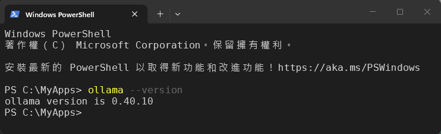

## 2. 安裝 LLM

你可以前往 Ollama 官網查詢[可用的 Models](https://ollama.com/search?c=local&c=tools)

假設你要安裝的是 [qwen2.5-coder:3b](https://ollama.com/library/qwen2.5-coder:3b)，只需要在終端機執行 `ollama pull qwen2.5-coder:3b` 即可。

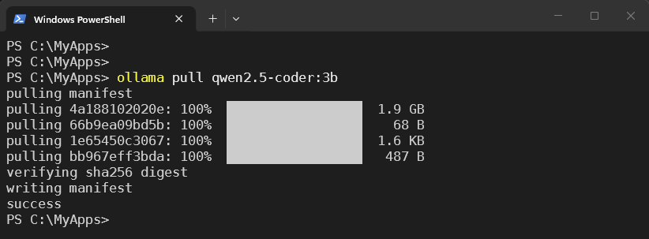

怎麼確認安裝成功？執行 `ollama list` 只要清單中出現你剛剛 pull 的 LLM 名稱，就表示已經安裝成功。

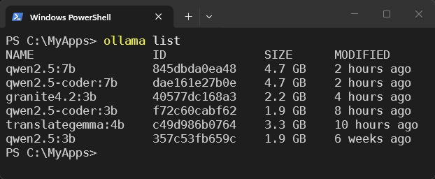

## 3. 啟動 Ollama

在終端機視窗下執行：`ollama serve` 啟動 Ollama 服務。

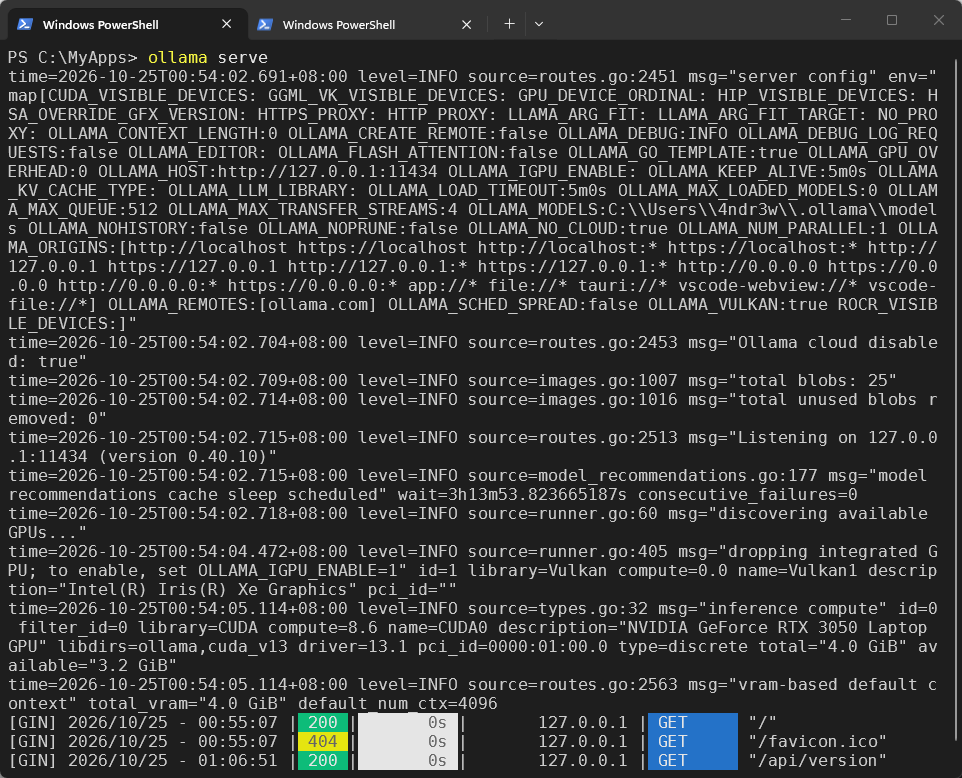

NOTE: 你也可以使用此儲存庫附的 [start_ollama.bat](start_ollama.bat) 啟用 Ollama。

如何驗證是否有成功？

開啟網頁瀏覽器，前往 `http://localhost:11434/` 若看見 `Ollama is running` 表示 Ollama 已經在本機運作。

啟動 Ollama 時，還可以帶入環境變數，有興趣的自行研究。

* `OLLAMA_DEBUG`：顯示額外的除錯資訊（例如：`OLLAMA_DEBUG=1`）
* `OLLAMA_HOST`：Ollama 伺服器的 IP 位址（預設值：`127.0.0.1:11434`）
* `OLLAMA_CONTEXT_LENGTH`：預設使用的上下文長度（若未特別指定，會依據顯存大小自動預設為 `4k`、`32k` 或 `256k`）
* `OLLAMA_KEEP_ALIVE`：模型在記憶體/顯存中保留駐留的時間（預設值：`5m`，即 5 分鐘）
* `OLLAMA_MAX_LOADED_MODELS`：每個 GPU 同時加載模型的最大數量
* `OLLAMA_MAX_TRANSFER_STREAMS`：拉取（pull）或推送（push）safetensors 模型時的最大平行傳輸串流數（預設值：`4`）
* `OLLAMA_MAX_QUEUE`：排隊等待處理的最大請求數量
* `OLLAMA_MODELS`：模型儲存目錄的路徑
* `OLLAMA_NUM_PARALLEL`：同時處理的最大平行請求數量
* `OLLAMA_NO_CLOUD`：停用 Ollama 雲端功能（遠端推論與網路搜尋）
* `OLLAMA_NOPRUNE`：啟動時不自動清理（prune）未引用的模型資料區塊（blobs）
* `OLLAMA_ORIGINS`：以逗號分隔的允許來源清單（CORS 跨來源存取設定）
* `OLLAMA_SCHED_SPREAD`：強制將模型分散調度至所有可用的 GPU 上
* `OLLAMA_FLASH_ATTENTION`：啟用快閃注意力機制（Flash Attention）
* `OLLAMA_KV_CACHE_TYPE`：K/V 快取量化類型（預設值：`f16`，可改設如 `q8_0` 或 `q4_0` 以節省顯存）
* `OLLAMA_LLM_LIBRARY`：手動指定 LLM 函式庫以繞過自動偵測
* `OLLAMA_GPU_OVERHEAD`：為每個 GPU 預留的顯存緩衝大小（單位：bytes）
* `OLLAMA_IGPU_ENABLE`：啟用內建顯示晶片（內顯 / iGPU）
* `LLAMA_ARG_FIT`：啟用 llama.cpp 自動配適未設定的記憶體選項（預設值：`"on"`）
* `LLAMA_ARG_FIT_TARGET`：llama.cpp 自動配適時，每個裝置預留的可用顯存安全邊際（單位：MiB）
* `OLLAMA_LOAD_TIMEOUT`：模型載入卡住時，放棄載入前的最長等待時間（預設值：`"5m"`，即 5 分鐘）

## 4. 安裝沉浸式翻譯

在你的網頁瀏覽器安裝[沉浸式翻譯](https://immersivetranslate.com/zh-TW/)擴充功能。

## 5. 設定使用本地翻譯服務

點擊瀏覽器的「沉浸式翻譯」擴充功能圖示，然後在頁面的左下角點擊「設定」，進入設定頁面。

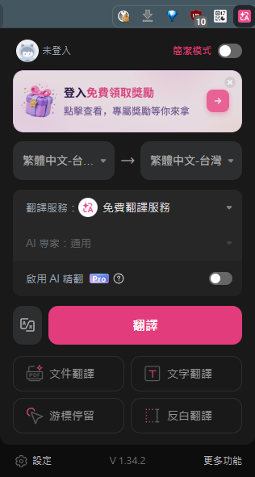

在設定頁面左邊的選單點擊「翻譯服務」，右側則是翻譯服務清單。

你可以看到系統除了「沉浸式翻譯」提供的免費服務（有限額）以外，還提供了 Google 翻譯服務。下方「其他/自訂」翻譯服務的清單中，你可以看到有 OpenAI 跟 Claude 可以設定，但我們要用的是左上角的「新增自訂翻譯服務」。

選擇清單中的 Ollama

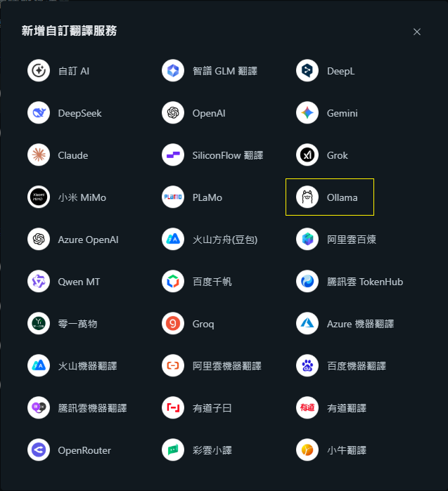

在這個頁面中，你唯一需要輸入的就是模型名稱，其他的設定基本上維持預設值就可以。

操作步驟如下：

1. 勾選「輸入自訂模型」，填上你剛剛 pull 下來的模型名稱（ex: qwen2.5-coder:3b）。
2. 可在「自訂翻譯服務名稱」欄位輸入辨識的名稱。
3. 點擊設定頁面右上角的「點此測試服務」，如果出現綠色勾勾，代表連線沒有問題，您已經可以調用本地端的模型進行翻譯服務。
4. 記得在左邊的「翻譯服務清單」中，將你設定的服務打勾啟用。

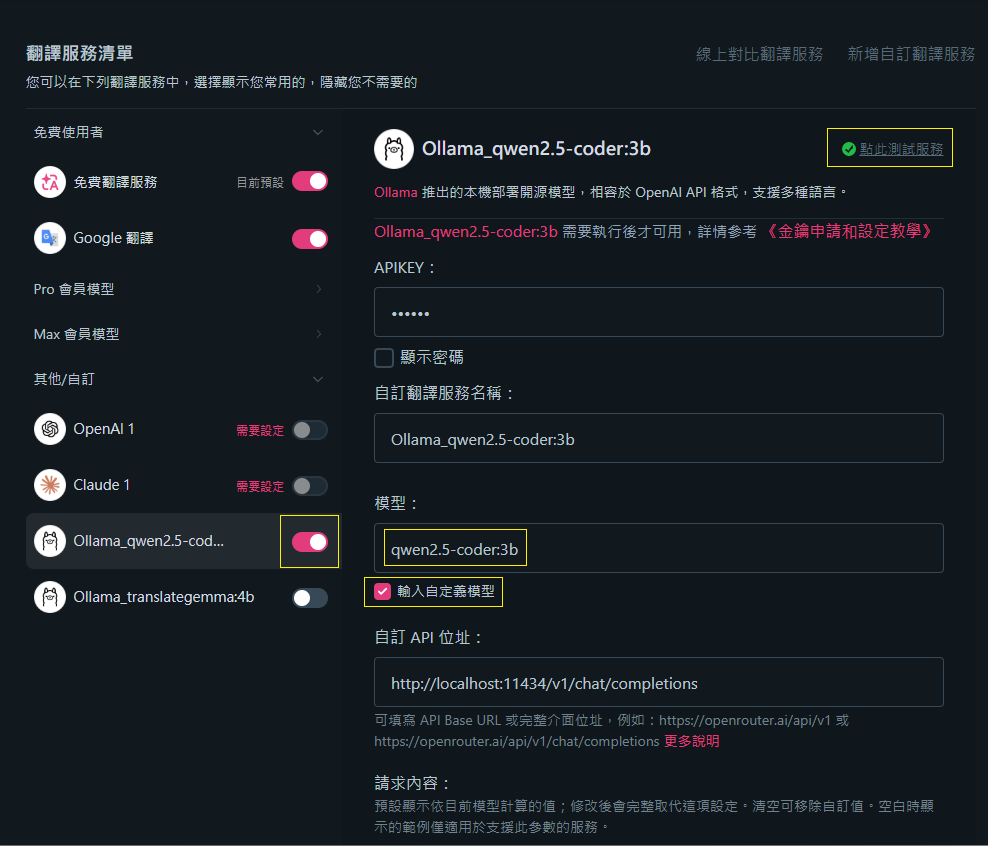

點選瀏覽器上的擴充功能圖示，然後在「翻譯服務」下拉選單中，選擇你剛剛設定的 Ollama 翻譯服務

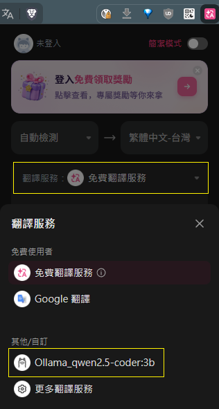 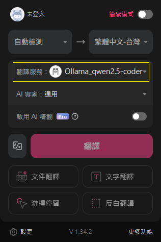

你就可以找任何一個英文網頁做測試。根據沉浸式翻譯的設計，你可以點擊網頁右手邊的懸浮圖示，擴充功能將會翻譯網頁上的英文，並提供中英文對照。如果你發現網頁可以正常翻譯，就代表你的 LLM 串接是沒有問題的。

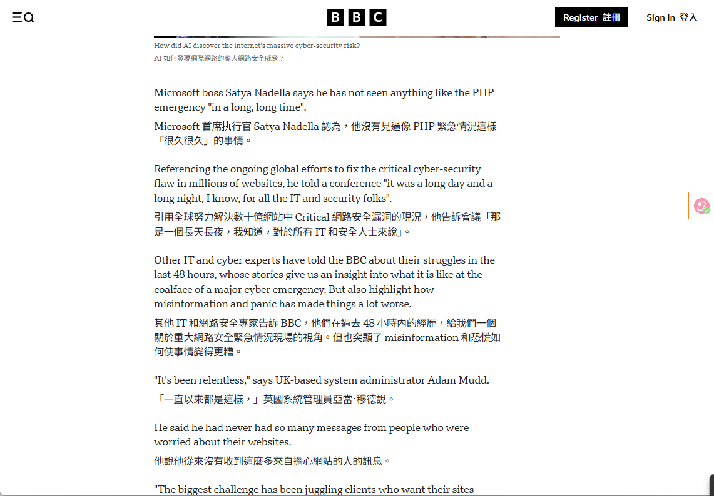

Youtube 影片的字幕也能正常翻譯

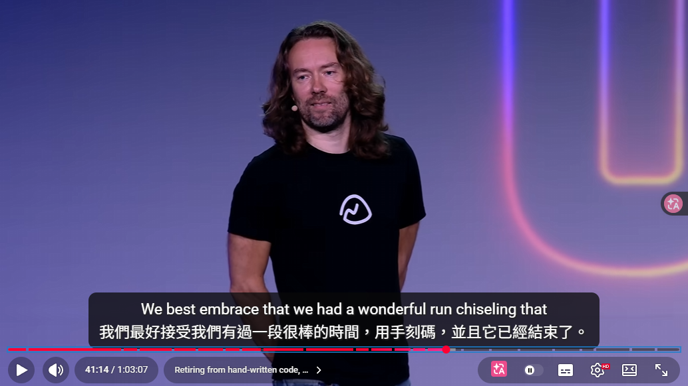

要怎麼證明此時沉浸式翻譯是透過本地端的 LLM 翻譯服務，而不是原本的雲端服務呢？

你可以觀察到 Ollama 的終端視窗會在翻譯過程中不斷刷新 log。

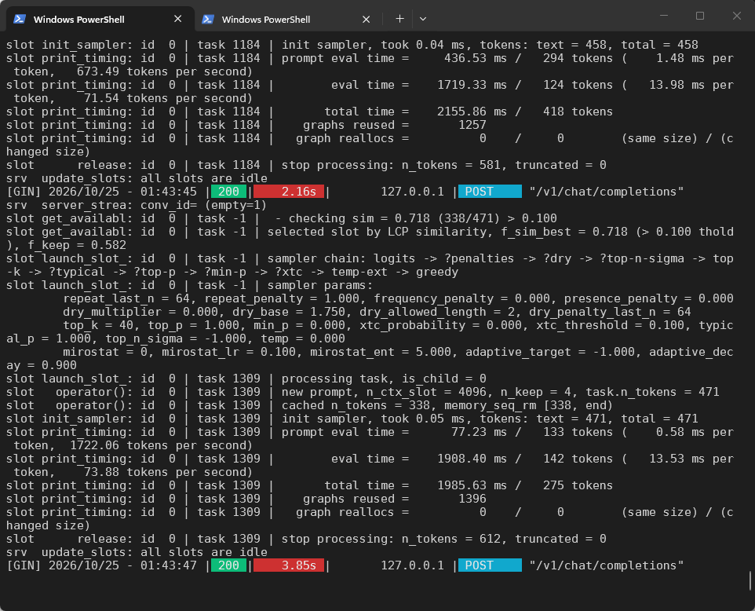

並且如果你打開工作管理員，可以看到你的顯示卡 GPU 使用率提高，GPU 記憶體的使用率也會提高。

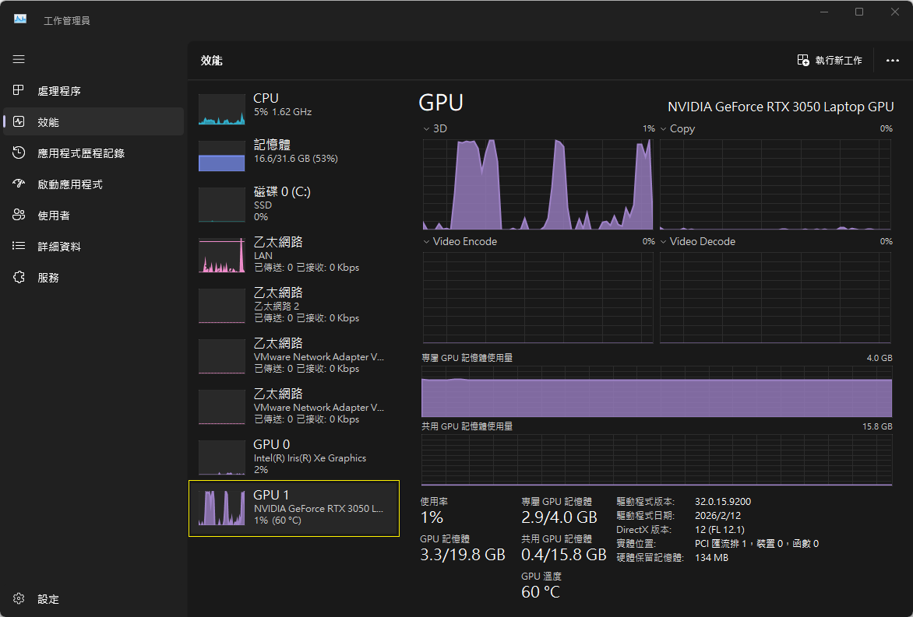

這證明了你目前的翻譯工作使用的是由本地端的 LLM 負責處理的，而不是雲端的翻譯服務。

## 6. 關於模型

我目前使用 `qwen2.5-coder:3b` 的原因，在於我的筆電顯卡（RTX 3050）僅有 4GB 顯存，無法流暢運行較大體積的模型。

特別提醒：此類即時網頁翻譯場景不適合使用推理型（Thinking）模型，否則每次請求都會因模型花時間「思考」而產生明顯延遲。

若你的硬體規格相仿，也可考慮專門用於翻譯的 [translategemma:4b](https://ollama.com/library/translategemma)（支援 55 種語言）。不過根據我實際測試，在我的筆電上運作速度稍微偏慢一點（其實我認為是可以接受的程度），且因為是 4B 規模，顯存占用也會比 3B 稍微多一點。

建議根據自身設備等級嘗試不同模型，在「翻譯品質」與「推論速度」之間取得最佳平衡。

~ END ~